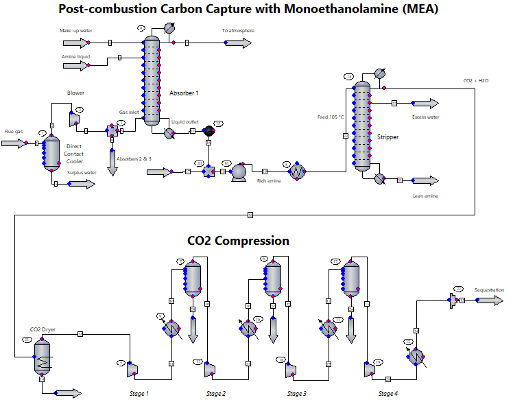

Fill out this <strong>[form](https://www.mathworks.com/academia/student-challenge/mathworks-excellence-in-innovation-signup.html?tfa_1=Post-Combustion%20Carbon%20Capture,%20Utilization,%20and%20Sequestration%20Modeling&tfa_2=261)</strong> to <strong>register</strong> your intent to complete this project.

Fill out this <strong>[form](https://www.mathworks.com/academia/student-challenge/mathworks-excellence-in-innovation-submission-form.html?tfa_1=Post-Combustion%20Carbon%20Capture,%20Utilization,%20and%20Sequestration%20Modeling&tfa_2=261)</strong> to <strong>submit</strong> your solution to this project and qualify for the rewards.

<table>
<td></td>
<td><p><h1>Post-Combustion Carbon Capture, Utilization, and Sequestration Modeling</h1></p>
<p>Design, cost, and optimize an MEA-based post-combustion CO₂ capture and compression plant by connecting CHEMCAD to MATLAB.</p>
</table>

**_Industry Partner_:**<br>
<br>
<a href="https://www.datacor.com/solutions/education" target="_blank" style="display: inline-block; text-align: center;">
    <br>
</a>

## Motivation

CO2 contributes to climate change. In order to mitigate that, engineers and scientists explore various technologies to capture CO2. Post-combustion carbon capture aims to separate CO2 from flue gas generated from fossil fuel combustion in a coal-fired power plant. The captured CO2 can be directly utilized to produce other chemicals such as methane and methanol. The captured CO2 can also be compressed to a state of near supercritical liquid in preparation for transportation and permanent storage in deep geologic formation.

In this project, you will investigate the design of a post-combustion carbon capture, utilization, and sequestration plant and its optimization with MATLAB and CHEMCAD, a Datacor product. This project description is nominated by Dr. Yuhe Tian, West Virginia University from Chemical and Biomedical Engineering Department and assigned in CHE 355 Junior Design Course. The course is jointly supported by MathWorks engineers and Datacor engineers.


## Project Description

The goal of this project is to design and improve a post-combustion CO2 capture and compression process for a coal-fired power plant. You will start from a base-case process that uses monoethanolamine (MEA) to capture CO2 from flue gas and then compresses the captured CO2 for transportation, utilization, or storage.

You will use CHEMCAD to model and simulate the process and MATLAB to analyze and improve its performance and calculate costs. Using the connection between MATLAB and CHEMCAD, you will evaluate different operating conditions and process modifications, perform cost and uncertainty analyses, and optimize selected design parameters. The objective is to identify improvements that reduce cost and resource consumption while meeting the required CO2 purity and recovery specifications.

At the end of the project, you will compare the improved design with the base case using key performance metrics such as cost, energy consumption, raw material consumption, productivity, and carbon emissions, and benchmark the final design against results reported in the literature.

**Suggested Steps:**

1. Familiarize yourself with MATLAB and various toolboxes fitting to this project. Tools and resources are mapped to each step and task of this project description below. MATLAB can be used for cost calculations, uncertainty analysis using Monte Carlo Simulations, custom unit models and reaction kinetics calculations, and optimizations. The self-paced courses on [MATLAB Academy](https://matlabacademy.mathworks.com/?page=1&amp;sort=featured) (solving equations, optimization, machine learning &amp; AI, statistics and more) and the [MathWorks Videos](https://www.mathworks.com/videos/search.html?q=&amp;page=1) are a good starting point, and [MATLAB Copilot](https://www.mathworks.com/products/matlab-copilot.html) (AI assistance within MATLAB) or the browser-based [AI Chat Playground](https://www.mathworks.com/matlabcentral/playground/presets/assistant) in the MATLAB Central user community can help you while writing code. The suggested products for this project are:
    - [MATLAB](https://www.mathworks.com/products/matlab.html) for core programming, visualization and [Live Scripts](https://www.mathworks.com/help/matlab/matlab_prog/what-is-a-live-script-or-function.html)
    - [Statistics and Machine Learning Toolbox](https://www.mathworks.com/products/statistics.html) for design of experiments, regression, Gaussian process regression, lasso/ridge and surrogate modeling workflows
    - [Optimization Toolbox](https://www.mathworks.com/products/optimization.html) for `fmincon`, `lsqcurvefit`/`lsqnonlin` for fitting, and constrained optimization
    - [Global Optimization Toolbox](https://www.mathworks.com/products/global-optimization.html) for `surrogateopt`, `patternsearch` and `ga`/`particleswarm`, which are helpful for expensive or non-smooth flowsheet objectives
    - Optionally, [Simulink Design Optimization](https://www.mathworks.com/products/sl-design-optimization.html) for sensitivity analysis workflows for Simulink models and [SimBiology](https://www.mathworks.com/products/simbiology.html) for kinetics, parameter estimation and sensitivity/uncertainty analysis of ODE models
2. Familiarize yourself with [CHEMCAD](https://www.datacor.com/products/chemcad) to perform the process simulation in CHEMCAD.
3. To connect MATLAB with CHEMCAD, utilize [Industrial Communication Toolbox](https://www.mathworks.com/products/industrial-communication.html). CHEMCAD communicates with MATLAB using OPC-DA which is available up to MATLAB R2024b. Follow the instructions [here](https://mathworks-my.sharepoint.com/:b:/p/ahaciogl/IQBDsssvOvi3S7SRqKfvM5LBAXcb9rQOntsROEJ71XEI5pI?e=3j1qAQ) to connect MATLAB with CHEMCAD. The [MATLAB-CHEMCAD webinar](https://content.mathworks.com/viewer/68d6e690f464d10b562fcef7) by Dr. Yuhe Tian, MathWorks and Datacor engineers demonstrates how MATLAB and CHEMCAD work together for this type of project.

### Base-Case CHEMCAD Process Simulation

#### Post-Combustion Carbon Capture with Monoethanolamine (MEA)

CO<sub>2</sub> reactive absorption with amine solution (e.g., MEA) presents a well-established commercial process for industrial carbon capture. A base case flowsheet is provided in [Figure 1](#figure-1). The flue gas comprises around 76 mol% N<sub>2</sub>, 12% O<sub>2</sub>, 8% H<sub>2</sub>O, and 4% CO<sub>2</sub>. The flue gas first enters a direct contact cooler to lower the temperature to around 40 °C. A blower is then used to pressurize the flue gas to overcome the pressure drop of the next-step absorber column. The flue gas is fed to the bottom of the absorber column. Note that three absorber columns are used to process the inlet flue gas. Only the first absorber column is simulated, and the other two columns are treated as identical. A liquid aqueous amine stream is fed to the top of the absorber column. The water wash stream is also fed at the top to minimize amine losses. CO<sub>2</sub> is removed via the counter-current flow of the flue gas and amine stream at around atmospheric pressure. Note that this is reactive absorption of CO<sub>2</sub>. The reaction mechanism is as follows:

```math
\begin{aligned}
2\,\mathrm{R{-}NH_2} + \mathrm{CO_2} &\rightleftharpoons \mathrm{R{-}NH_3^{+}} + \mathrm{R{-}NH{-}COO^{-}} \\
\mathrm{R{-}NH_2} + \mathrm{CO_2} + \mathrm{H_2O} &\rightleftharpoons \mathrm{R{-}NH_3^{+}} + \mathrm{HCO_3^{-}}
\end{aligned}
```

This reactive absorption process is modeled using Amine as the customized K-value model, which uses the Kent-Eisenberg method to model the reactions. The rich amine leaves from the bottom of the absorber column and then heated to 105 °C before entering the CO<sub>2</sub> stripper. Column convergence is improved by setting the damping factor to 0.5 and by using simple estimations for initialization. Reboiler temperature should be maintained around or lower than 120 °C to minimize amine thermal degradation. A partial condenser is used to obtain high-purity CO<sub>2</sub> stream from the top. A surplus water take-off flow is also extracted from stage 1. Lean amine stream is obtained from the bottom of the stripper.

If you want to go beyond the Kent-Eisenberg base case with a kinetics-focused study (rate expressions, alternative solvents, validation vs. literature), you can derive rate equations with [Symbolic Math Toolbox](https://www.mathworks.com/help/symbolic/index.html) by [solving equations symbolically](https://www.mathworks.com/help/symbolic/equation-solving.html) and [solving differential equations symbolically](https://www.mathworks.com/help/symbolic/solve-a-single-differential-equation.html), solve the rate equations or custom unit models (e.g., membrane separation) numerically with the MATLAB [ODE solvers](https://www.mathworks.com/help/matlab/numerical-integration-and-differential-equations.html), and solve systems of nonlinear equations with [`fsolve`](https://www.mathworks.com/help/optim/ug/fsolve.html) from Optimization Toolbox. [SimBiology](https://www.mathworks.com/products/simbiology.html) can help with model building, parameter estimation and sensitivity: define the reactions with [`SimBiology.Reaction`](https://www.mathworks.com/help/simbio/ref/simbiology.reaction.html) and their rate expressions with [`SimBiology.KineticLaw`](https://www.mathworks.com/help/simbio/ref/simbiology.kineticlaw.html), estimate the kinetic parameters with the least-squares and global/local solvers [supported for parameter estimation in SimBiology](https://www.mathworks.com/help/simbio/ug/supported-methods-for-parameter-estimation.html), and study parameter sensitivity with [global/local sensitivity analysis in SimBiology](https://www.mathworks.com/help/simbio/global-local-sensitivity-analysis-matlab-simbiology.html), for example with [Sobol indices](https://www.mathworks.com/help/simbio/ug/sobol-indices-global-sensitivity-analysis-example-simbiology.html). The [Bioreactor Modeling and Optimization with MATLAB, Simulink, SimBiology](https://content.mathworks.com/viewer/68d6e690f464d10b562fcef7) example shows how [Simulink](https://www.mathworks.com/products/simulink.html) and SimBiology support parameter estimation and sensitivity analysis while solving rate equations.

#### CO<sub>2</sub> Compression

The high-purity CO<sub>2</sub> stream first enters a dryer unit to remove most of the water. A four-stage compression is then used with 40 °C as the fixed inlet temperature for each stage. In this system, CO<sub>2</sub> is close to the super-critical state where the temperature is greater than the critical temperature making fugacity calculation difficult. The Benedict-Webb-Rubin-Starling (BWRS) equation of state is used, as it allows the use of parameters specific to the properties of CO<sub>2</sub>.

<a id="figure-1"></a>
<p align="center">
  
  <br>
  <em>Figure 1: Base Case CHEMCAD Simulation Flowsheet (Unit 100).</em>
</p>

### Simulation (CHEMCAD) Hints

- The global K-value and Enthalpy methods are set as Amine. Local K-value and Enthalpy methods are set as BWRS for the CO<sub>2</sub> compression section.
- All compressors are adiabatic with 70% efficiency.
- All distillation columns should use the rigorous SCDS simulation, the number of <ins>**actual**</ins> trays and pressure drops should be given, and flooding should lie in the range of 35–75%. For consistency, use a 12″ tray spacing, 80% active tray area.

### Process Specification

The captured CO<sub>2</sub> stream should have a purity higher than **95 mol%** with **~85% recovery** from the flue gas stream.

### Cost Calculations, Uncertainty Analysis, and Optimization in MATLAB

#### Base Case Simulation and Cost Analysis

- Estimate the EAOC of the base case and a breakdown of the utilities and equipment in terms of the *fraction* of EAOC – pie chart or bar graph required. In MATLAB, implement the costing correlations and utility costs of [Appendix A](#appendix-a--equations-for-equipment-costing-and-eaoc-calculations) and [Appendix B](#appendix-b--other-information) as functions (e.g., in a [Live Script](https://www.mathworks.com/help/matlab/matlab_prog/what-is-a-live-script-or-function.html)) that take the equipment sizes and duties from CHEMCAD and return the purchase costs, CI, OC and EAOC. This lets you automate the plots and tables for the report, for example the EAOC breakdown with [`piechart`](https://www.mathworks.com/help/matlab/ref/piechart.html) or [`bar`](https://www.mathworks.com/help/matlab/ref/bar.html), and reuse the same code later as the objective function for optimization.

#### Optimization

- For the entire flowsheet, determine and implement **3** major areas for process improvement of the base case. To find where improvements matter most, use [Design of Experiments (DOE)](https://www.mathworks.com/help/stats/design-of-experiments.html) from Statistics and Machine Learning Toolbox to explore the decision variables efficiently (e.g., MEA wt%, L/G ratio, lean loading, stripper pressure, reboiler duty setpoint, intercooler temperatures, compressor pressure ratios): use screening designs (fractional factorial) to find dominant effects, response surface designs to build quadratic surrogates for optimization, and space-filling designs (Latin hypercube/quasi-random) when the variables are continuous and bounded. Rank which inputs drive EAOC with local or global sensitivity analysis (see [What Is Sensitivity Analysis?](https://www.mathworks.com/help/sldo/ug/what-is-sensitivity-analysis.html) for the concepts, including Monte Carlo-based methods, and [Sensitivity Analysis](https://www.mathworks.com/help/sldo/sensitivity-analysis.html) in Simulink Design Optimization for the workflows), and fit the DOE results with the [Regression Learner App](https://www.mathworks.com/help/stats/regression-learner-app.html), [`fitlm`](https://www.mathworks.com/help/stats/fitlm.html) for linear regression, [`lasso`](https://www.mathworks.com/help/stats/lasso.html) for feature selection / sparse regression, or [`ridge`](https://www.mathworks.com/help/stats/ridge.html) for regularized regression.
- Using the CHEMCAD-MATLAB connection:
    - Determine and implement **1** major area for process improvement. Formulate it in MATLAB as an optimization problem: minimize EAOC subject to 95 mol% CO<sub>2</sub> purity, ~85% recovery, reboiler temperature 120 °C and practical equipment/operability bounds. [`fmincon`](https://www.mathworks.com/help/optim/ug/fmincon.html) from Optimization Toolbox is the workhorse constrained nonlinear solver. Because each objective evaluation requires a CHEMCAD flowsheet run (expensive, sometimes noisy), also consider global/derivative-free approaches such as [surrogate optimization (`surrogateopt`)](https://www.mathworks.com/help/gads/surrogate-optimization.html) from Global Optimization Toolbox (see this [comparison of `surrogateopt` vs `fmincon` vs `patternsearch`](https://www.mathworks.com/help/gads/compare-surrogateopt-to-other-solvers.html)), or approximate the CHEMCAD evaluations with a surrogate model based on [Gaussian process regression](https://www.mathworks.com/help/stats/gaussian-process-regression.html) (kriging), trained with [`fitrgp`](https://www.mathworks.com/help/stats/fitrgp.html) (see [Gaussian Process Regression Models](https://www.mathworks.com/help/stats/gaussian-process-regression-models.html) for theory and options), which also makes optimization and Monte Carlo analysis at scale practical. The [Optimize Green Hydrogen Production System](https://www.mathworks.com/help/optim/ug/optimize-green-hydrogen-production.html) example shows a techno-economic optimization (NPV objective) whose pattern transfers directly to EAOC.
    - Perform an uncertainty analysis (e.g., Monte Carlo simulation) and study the impact on e.g. cost. Examples of uncertainties include CO<sub>2</sub> composition in flue gas, electricity price, policy regulation, etc. In MATLAB, define the uncertain inputs (CO<sub>2</sub> mol% in flue gas, electricity price, steam cost, policy/regulatory scenarios) as distributions, sample them, and for each sample evaluate the flowsheet KPIs and EAOC (by direct CHEMCAD call or with your surrogate model). Report the EAOC distribution (histogram/CDF), the probability of meeting the specs, and the key uncertainty drivers (tornado / correlation). See [What is Monte Carlo Simulation?](https://www.mathworks.com/discovery/monte-carlo-simulation.html) for an overview of the relevant MathWorks tools in MATLAB and Simulink, [Monte Carlo Analysis](https://www.mathworks.com/help/robust/monte-carlo-analysis.html) in [Robust Control Toolbox](https://www.mathworks.com/products/robust.html) for sampling uncertain systems, and the [Batch Process Optimization with MATLAB](https://www.mathworks.com/videos/batch-process-optimization-with-matlab-1623231967689.html) example.
- Determine the effect on EAOC of the chosen improvement strategies. Re-run your MATLAB EAOC calculation for each improved design and compare it with the base case using the same [`piechart`](https://www.mathworks.com/help/matlab/ref/piechart.html) or [`bar`](https://www.mathworks.com/help/matlab/ref/bar.html) charts.
- Present a radar chart to illustrate the final improved performance metrics compared to the base case (e.g., economics, energy consumption, raw material consumption, productivity, carbon emissions). In MATLAB, normalize each metric to the base case and plot both designs on the same axes with [`polarplot`](https://www.mathworks.com/help/matlab/ref/polarplot.html).
- Validate and benchmark your final improved design performance with that reported in the open literature.

## Appendix A – Equations for Equipment Costing and EAOC Calculations

The EAOC is defined as below:

```math
\mathrm{EAOC} = \frac{\mathrm{CI}}{\mathrm{PWF}} + \mathrm{OC}
```

where *PWF* is the present worth factor that may be taken as 7.0 for this project and

```math
\mathrm{CI} = 6 \sum_i (PC)_i
```

where the purchase costs (*PC*)<sub>*i*</sub> for each piece of equipment shown on the PFD must be determined.

### Purchase Costs (PC)

**Cost of Tower**

```math
\log_{10}\left(PC\,[\$]\right) = 4.50 + 0.449 \log_{10} V + 0.107 \left[\log_{10} V\right]^2
```

where *V* = volume of tower (m<sup>3</sup>). The above cost for the tower includes the cost of the reflux drum and reflux pump but does not include the cost of the trays (see below), and the two exchangers (reboiler and condenser), both of which should be costed separately as heat exchangers.

**Cost of a Single Tray**

```math
\log_{10}\left(PC\,[\$]\right) = 3.332 + 0.484 \log_{10} A + 0.343 \left[\log_{10} A\right]^2
```

where *A* = cross sectional area of the tower (m<sup>2</sup>).

**Cost of Exchanger**

```math
\log_{10}\left(PC\,[\$]\right) = 4.6 - 0.8 \log_{10} A + 0.3 \left[\log_{10} A\right]^2
```

where *A* = heat exchange area (m<sup>2</sup>). **The correlation is good for *A* ≥ 20 m<sup>2</sup>; for *A* < 20 m<sup>2</sup> use the value at *A* = 20 m<sup>2</sup>.** Note: when warranted, multiple zone calculations for heat exchangers may be required and the TOTAL AREA for the heat exchanger will be the combined areas for each of the zones.

**Cost of Pumps** (not required for overhead reflux pumps)

```math
\log_{10}\left(PC\,[\$]\right) = 3.48 + 0.054 \log_{10} W_s + 0.154 \left[\log_{10} W_s\right]^2
```

where *W*<sub>*s*</sub> = shaft work (kW) (assume 60% efficiency).

**Cost of Fired Heaters**

```math
\log_{10}\left(PC\,[\$]\right) = 7.35 - 1.167 \log_{10} Q + 0.203 \left[\log_{10} Q\right]^2
```

where *Q* = duty of fired heater (kW) (assume 90% efficiency).

**Cost of Vertical Vessels** – Same as tower.

**Cost of Horizontal Vessels**

```math
\log_{10}\left(PC\,[\$]\right) = 3.56 + 0.378 \log_{10} V + 0.091 \left[\log_{10} V\right]^2
```

where *V* = volume of vessel (m<sup>3</sup>).

**Cost of Reactors**

```math
\log_{10}\left(PC\,[\$]\right) = 4.0 + 0.7 \log_{10} V + 0.3 \left[\log_{10} V\right]^2
```

where *V* = volume of reactor (m<sup>3</sup>).

**Cost of Compressors**

```math
\log_{10}\left(PC\,[\$]\right) = 2.2897 + 1.3604 \log_{10} W - 0.1027 \left[\log_{10} W\right]^2
```

where *W* = power (kW) (assume 80% efficiency).

### Costs of Utilities and Other Operating Costs (OC)

| Utility | Cost |
|---|---|
| Dowtherm™ A (DT, *T*<sub>in</sub> = 450 °C, *T*<sub>out</sub> = 400 °C) | \$6.50/GJ |
| Low-Pressure Steam (lps – sat'd 150 °C) | \$4.54/GJ |
| Medium-Pressure Steam (mps – sat'd 205 °C) | \$4.77/GJ |
| High-Pressure Steam (hps – sat'd 260 °C) | \$5.66/GJ |
| Cooling Water (cw – supply 30 °C and return 40 °C) | \$0.378/GJ |
| Refrigerated Water (rw – supply 5 °C and return 15 °C) | \$4.77/GJ |
| Electricity | \$18.72/GJ (\$0.0674/kWh) |
| Wastewater disposal cost | \$60/1000 m<sup>3</sup> of water treated |

**Waste Heat Price**

If you choose to generate steam in any heat exchanger, you may take a credit of \$4.00/GJ for any steam generated.

**Fuel Gas Credit**

For purge stream(s) that may be burned as fuel gas, credit may be taken for LHV at \$2.50/GJ.

## Appendix B – Other Information

For sizing heat exchangers, a preliminary design using the following overall heat transfer coefficients should be used.

| Service | *U* (W/m<sup>2</sup> °C) |
|---|---|
| Condensers and Reboilers | 1000 |
| One side gas – other side condensing/boiling | 60 |
| One side liquid – other side condensing/boiling | 500 |
| One side gas – other side liquid | 55 |
| Both sides gas | 30 |
| Both sides liquid | 250 |


## Background Material

1. Turton, R., Shaeiwitz, J. A., Bhattacharyya, D., & Whiting, W. B. (2018). *Analysis, synthesis, and design of chemical processes* (5th ed.). Pearson Education.
2. Seader, J. D., Henley, E. J., & Roper, D. K. (2016). *Separation process principles with applications using process simulators* (4th ed.). John Wiley & Sons.


## Impact

Reduce climate impact of CO2 by carbon capture, storage and utilization in other chemicals manufacturing.

## Expertise Gained 

Sustainability and Renewable Energy, Modeling and Simulation, Optimization, Reaction kinetics

## Project Difficulty

Bachelor

## Project Discussion

[Dedicated discussion forum](https://github.com/mathworks/MATLAB-Simulink-Challenge-Project-Hub/discussions/190) to ask/answer questions, comment, or share your ideas for solutions for this project.

## Project Number

261
